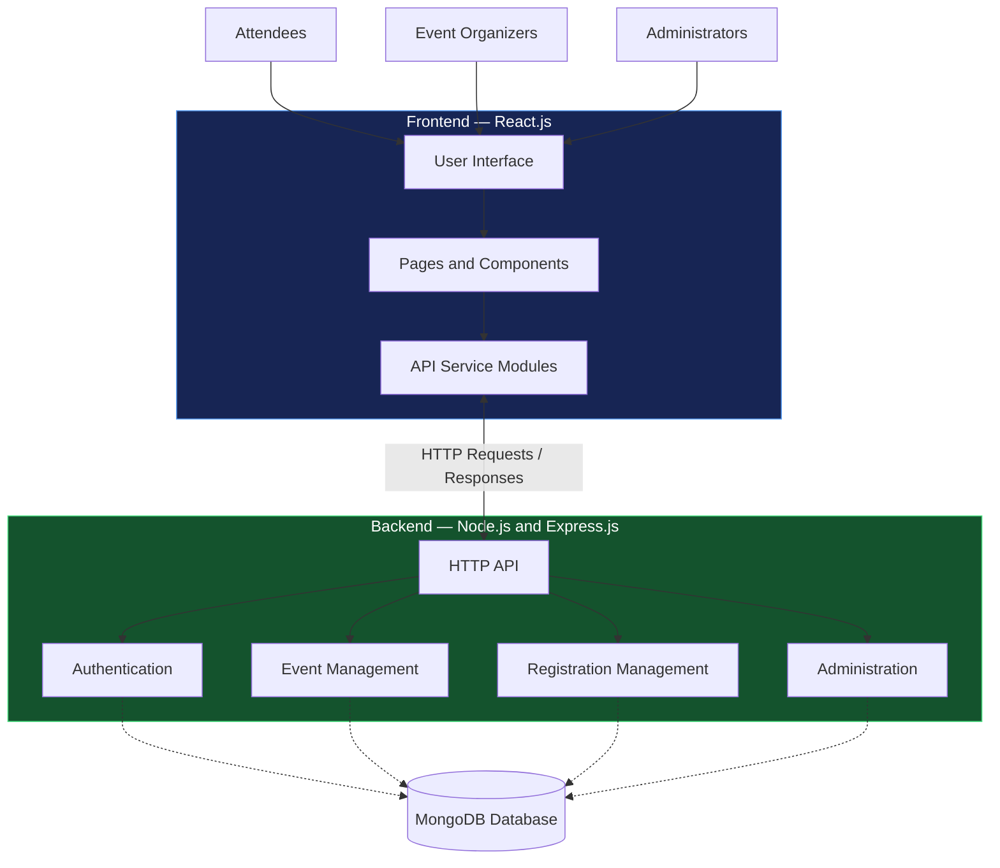

# 🎉 CityEvent

<h3 align="center">Discover What's Happening Around You.</h3>

<p align="center">
  <strong>Find events. Meet people. Create experiences.</strong>
</p>

<p align="center">
  A modern event discovery and management platform that brings local communities, event organizers, and unforgettable experiences together.
</p>

---

## ✨ One Platform. Endless Experiences.

Finding interesting events shouldn't be difficult. **CityEvent** aims to make discovering events and managing event activities easier through a single web platform.

Whether you're exploring events as an attendee, organizing your next gathering, or managing the platform as an administrator, CityEvent brings these experiences together in one place.

## 🚀 What Makes CityEvent Special?

<table>
  <tr>
    <td width="50%" valign="top">
      <h3>🎭 Discover Events</h3>
      Explore event listings, check event details, and find experiences worth attending.
    </td>
    <td width="50%" valign="top">
      <h3>🎟️ Easy Registration</h3>
      Access event registration interfaces and review registration information.
    </td>
  </tr>
  <tr>
    <td width="50%" valign="top">
      <h3>📅 Organizer Workspace</h3>
      Create, edit, and manage events through dedicated organizer pages.
    </td>
    <td width="50%" valign="top">
      <h3>🛡️ Admin Control Center</h3>
      Dedicated interfaces for event reviews, categories, users, organizers, and registrations.
    </td>
  </tr>
</table>

## 👥 Built for Every Side of an Event

| 🎉 Attendees | 🎤 Organizers | 🛡️ Administrators |
|---|---|---|
| Explore event details | Create and edit events | Review event submissions |
| Access registration pages | Manage event participants | Manage event categories |
| Manage profile information | View organizer dashboard | Manage users and organizers |

## 💻 Technology Stack

CityEvent uses a full-stack web architecture, with the following technologies represented in the project.

| Layer | Technology |
|---|---|
| Frontend | React.js, JavaScript, HTML, CSS |
| Routing | React Router |
| API Communication | API service modules |
| Backend | Node.js, Express.js |
| Database | MongoDB, if configured |
| Version Control | Git and GitHub |

## 🏗️ System Architecture

CityEvent is organized around a frontend, backend, and data layer. Users interact with the React frontend, which communicates with the backend through HTTP requests. The backend handles application logic and accesses the database when configured.



*Architecture overview: database connections and individual backend operations should be considered implemented only where supported by the actual code.*

## 🗂️ Inside the Project

```text
CityEvent/
├── backend/
│   ├── server.js
│   ├── package.json
│   └── .env.example
│
├── frontend/
│   ├── public/
│   ├── src/
│   │   ├── assets/
│   │   ├── components/
│   │   ├── context/
│   │   ├── data/
│   │   ├── pages/
│   │   │   ├── admin/
│   │   │   ├── auth/
│   │   │   ├── organizer/
│   │   │   └── user/
│   │   └── services/
│   ├── package.json
│   └── vite.config.js
│
├── .gitignore
└── README.md
```

## ⚡ Get Started

### Prerequisites

- Node.js and npm
- Git
- MongoDB, if required by the backend configuration

### 1. Clone the Repository

```bash
git clone https://github.com/soundarya820/CityEvent.git
cd CityEvent
```

### 2. Install Backend Dependencies

```bash
cd backend
npm install
```

Configure your environment variables using `backend/.env.example` as a reference. Create a local `.env` file with your own settings. Never commit real credentials or secrets.

### 3. Start the Backend

Check the scripts in `backend/package.json`. If a `start` script is defined, run:

```bash
npm start
```

### 4. Install Frontend Dependencies

Open another terminal from the project root and run:

```bash
cd frontend
npm install
```

### 5. Start the Frontend

If the frontend uses Vite, run:

```bash
npm run dev
```

Open the local URL shown in your terminal. Ensure the backend, database, and API configuration are set up as required.

## 🔮 What's Next?

- 🔎 Smarter event discovery and filtering
- 📍 Location-based event exploration
- 🔔 Event reminders and notifications
- 💳 Online payment integration
- ☁️ Production deployment

*These are planned enhancements, not claims about currently implemented features.*

---

<p align="center">
  <strong>Built with 💜 by Soundarya Rukade</strong>
  <br/>
  <sub>Turning local discoveries into memorable experiences.</sub>
  <br/><br/>
  <a href="https://github.com/soundarya820/CityEvent">Explore the Repository</a>
  &nbsp; • &nbsp;
  <a href="https://github.com/soundarya820">More Projects</a>
</p>
